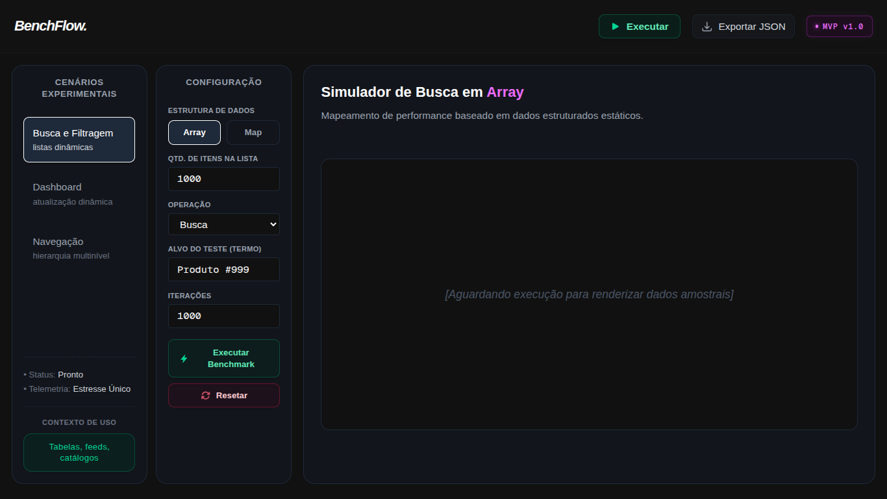
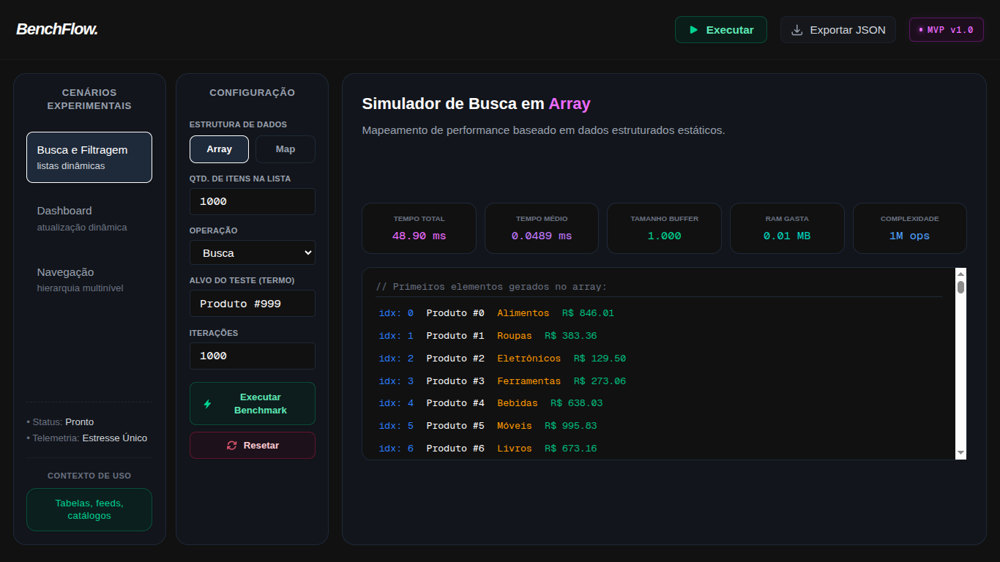
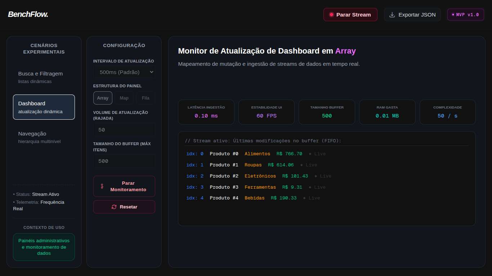
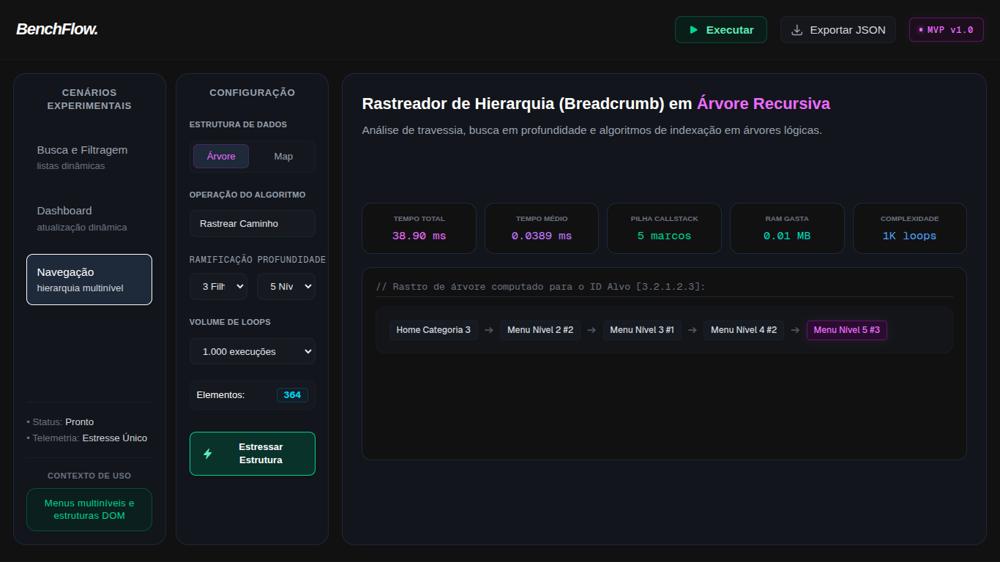

# 🖥️ BenchFlow
O BenchFlow é um ambiente web experimental que foi projetado para ser uma ferramenta de benchmarking que permite aos usuários visualizar e comparar o desempenho de algumas estruturas empregadas em diferentes cenários técnicos em termos de performance e experiência do usuário dentro da camada de aplicação (front-end).

## 📊 Cenário de Benchmarking
- **Cenário 1:** Comparação entre Array e Map para operações de busca, filtragem e ordenação de dados com quantidade de elementos e iterações.
- **Cenário 2:** Análise de desempenho de diferentes estruturas de dados (Array, Map e Fila) em cenários de uso real com atualização dinâmica por meio do intervalo de frequência de atualização e tamanho máximo de buffer.
- **Cenário 3:** Comparação entre diferentes estruturas de dados (Árvores e Map) em cenários de navegação hierárquica por níveis com opções de rastreamento e planificação. Utilizado para simular a navegação em uma árvore de diretórios, onde cada nó representa um diretório e os filhos representam subdiretórios ou arquivos.

## 📸 Imagens do Projeto
<div style="display: flex-row; gap: 20px; flex-wrap: wrap;">
  
  
  
  
</div>


## 🧰 Tecnologias e Metodologias Utilizadas
- [Next.js](https://nextjs.org/)
- [TypeScript](https://www.typescriptlang.org/)
- [Tailwind CSS](https://tailwindcss.com/)
- [Vercel](https://vercel.com/)
- Docker e Docker

## ⚙️ Como Rodar o Projeto (Getting Started)
### 1. Por NPM (Node Package Manager)
1. Clone o repositório:
   ```bash
   git clone https://github.com/Gabb83/data-structure-benchmark.git
    ```
2. Navegue até o diretório do projeto:
    ```bash
    cd data-structure-benchmark
    ```
3. Instale as dependências (certifique-se de ter o Node.js instalado):
    ```bash
    npm install
    ```
4. Inicie o servidor de desenvolvimento:
    ```bash
    npm run dev
    ```
5. Abra o navegador e acesse `http://localhost:3000` para ver o aplicativo em ação.

### 2. Por Docker
1. Certifique-se de ter o Docker instalado em sua máquina.
2. Clone o repositório:
    ```bash
    git clone https://github.com/Gabb83/benchflow.git
    ```
3. Navegue até o diretório do projeto:
    ```bash
    cd benchflow
    ```
4. Construa a imagem Docker:
    ```bash
    docker compose up --build
    ```